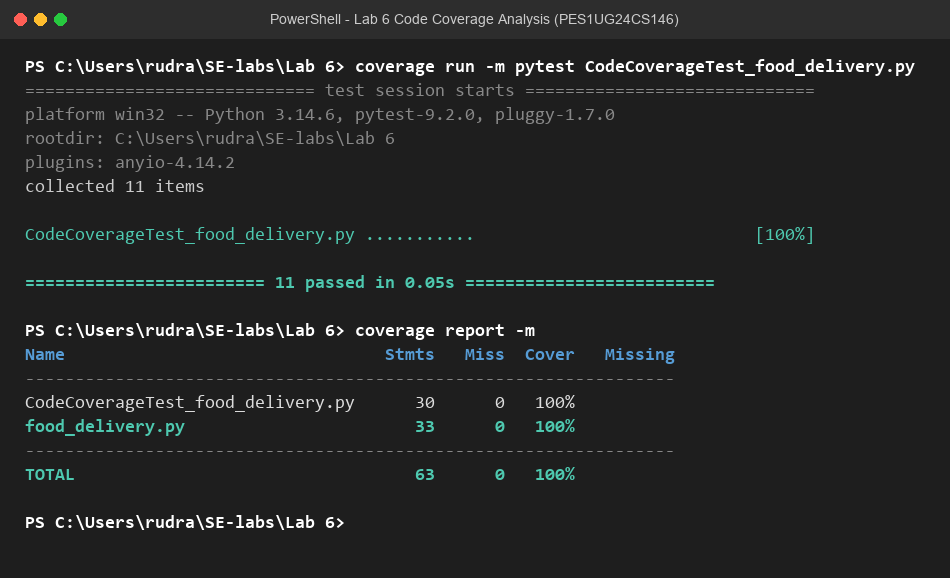
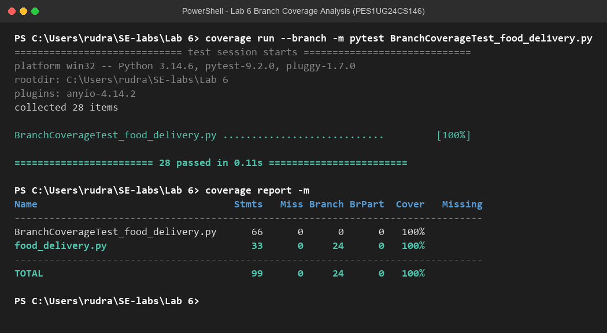

# Lab 6: Code and Branch Coverage Analysis

**Student Name:** Rudra Dhadhal  
**SRN:** PES1UG24CS146  
**Course:** Software Engineering (UE24CS342AA2)  
**Assigned Repository:** [SETAPESU26/L6_L7_20_food_delivery](https://github.com/SETAPESU26/L6_L7_20_food_delivery)  
**Module Under Test:** `food_delivery.py`

---

## 1. Objectives

- Differentiate between **code (line/statement) coverage** and **branch coverage**.
- Use Python's `coverage` tool to measure, analyze, and improve test suite completeness.
- Interpret coverage reports and identify untested execution paths, dead code, and logical edge cases.
- Design targeted test suites that evaluate decision branches, boolean short-circuits, and edge boundaries to achieve 100% coverage (exceeding the >=90% threshold).

---

## 2. Deliverables Summary

| Deliverable | Description | File Path |
|---|---|---|
| **Code Coverage Test Cases** | Targeted test cases exercising every statement (100% line coverage) | `CodeCoverageTest_food_delivery.py` / `CodeCoverageTest_PES1UG24CS146_food_delivery.py` |
| **Branch Coverage Test Cases** | Comprehensive test cases covering all decision branches & boundaries (100% branch coverage) | `BranchCoverageTest_food_delivery.py` / `BranchCoverageTest_PES1UG24CS146_food_delivery.py` |
| **Code Coverage Screenshot** | Terminal output screenshot showing 100% statement coverage | `code_coverage_analysis.png` |
| **Branch Coverage Screenshot** | Terminal output screenshot showing 100% branch coverage (0 missing branches) | `branch_coverage_analysis.png` |
| **Initial / Extended Tests** | Starter test file extended to cover application requirements | `test_food_delivery.py` |
| **Text Reports** | Coverage analysis reports generated via `coverage report -m` | `code_coverage_report.txt`, `branch_coverage_report.txt` |

---

## 3. Code Coverage vs. Branch Coverage Concepts

| Type | Definition | Focus |
|---|---|---|
| **Line Coverage** | Percentage of executable statements visited during testing. | *Did the execution flow pass through this line of code at least once?* |
| **Branch Coverage** | Percentage of decision branches (`if`, `elif`, `else`, boolean short-circuits) evaluated to both `True` and `False`. | *Did every control structure and conditional path evaluate to both possible outcomes?* |
| **Path Coverage** | Measures execution of every unique end-to-end combination of paths. | Tests all possible combinations of decision branches. |
| **Function Coverage** | Measures percentage of declared functions invoked during testing. | Verifies all module functions are called. |

### The Core Difference Illustrated
Line coverage can give a false sense of security. If a condition like `if distance_km <= 0 or distance_km > 15:` is only tested with negative distances, the statement inside executes and line coverage reports 100% for that block, yet the boundary `> 15` and valid boundary paths remain untested. Branch coverage forces tests to verify every decision path in both directions (True and False), uncovering edge cases and boundary bugs.

---

## 4. Phase 1: Code Coverage Analysis

### Test Design
The test suite in `CodeCoverageTest_food_delivery.py` is structured into three test classes targeting the functions in `food_delivery.py`:
- `TestDeliveryChargeCodeCoverage`: Validates distance thresholds, order value discount rules, and rain surcharge execution.
- `TestApplyCouponCodeCoverage`: Tests valid coupons, invalid codes, non-first order restrictions for `WELCOME`, and minimum spend limits.
- `TestEstimatedTimeCodeCoverage`: Tests travel time computation under combined peak hour and busy kitchen conditions.

### Results
- **Statements Covered:** 33 / 33 (100%)
- **Test Results:** 11 passed in 0.05s

```
PS C:\Users\rudra\SE-labs\Lab 6> coverage run -m pytest CodeCoverageTest_food_delivery.py
============================= test session starts =============================
platform win32 -- Python 3.14.6, pytest-9.2.0, pluggy-1.7.0
rootdir: C:\Users\rudra\SE-labs\Lab 6
plugins: anyio-4.14.2
collected 11 items

CodeCoverageTest_food_delivery.py ...........                            [100%]

======================== 11 passed in 0.05s ========================

PS C:\Users\rudra\SE-labs\Lab 6> coverage report -m
Name                                Stmts   Miss  Cover   Missing
-----------------------------------------------------------------
CodeCoverageTest_food_delivery.py      30      0   100%
food_delivery.py                       33      0   100%
-----------------------------------------------------------------
TOTAL                                  63      0   100%
```



---

## 5. Phase 2: Branch Coverage Analysis

### Decision Branch Matrix & Edge Cases Covered
The test suite in `BranchCoverageTest_food_delivery.py` targets all 24 branches across `food_delivery.py`:

| Function | Decision Point / Branch | Test Cases & Edge Values | Evaluated Outcome |
|---|---|---|---|
| `delivery_charge` | `distance_km <= 0 or distance_km > 15` | `distance = 0`, `distance = -5` | True (`ValueError: out of delivery range`) |
| `delivery_charge` | `distance_km <= 0 or distance_km > 15` | `distance = 16` | True (`ValueError: out of delivery range`) |
| `delivery_charge` | `distance_km <= 0 or distance_km > 15` | `distance = 0.1`, `distance = 15` | False (Valid boundaries accepted) |
| `delivery_charge` | `order_value >= 500` | `order_value = 500`, `order_value = 750` | True (`charge = 0`) |
| `delivery_charge` | `order_value >= 500` | `order_value = 499` | False (Falls through to distance tiers) |
| `delivery_charge` | `distance_km <= 3` | `distance = 3` (no rain), `distance = 1` (rain) | True (`charge = 20`, with rain `50`) |
| `delivery_charge` | `distance_km <= 8` | `distance = 8` (no rain), `distance = 5` (rain) | True (`charge = 40`, with rain `70`) |
| `delivery_charge` | `else` (> 8 km) | `distance = 12` (no rain), `distance = 15` (rain)| Else branch (`charge = 60`, with rain `90`)|
| `delivery_charge` | `is_raining` | Both `True` and `False` across tiers | True (+30) / False (+0) |
| `apply_coupon` | `code is None` | `code = None` (first order & returning order) | True (returns `order_value`) |
| `apply_coupon` | `code not in COUPONS` | `code = "FLAT50"` | True (`ValueError: invalid coupon`) |
| `apply_coupon` | `code == "WELCOME" and not is_first_order` | `WELCOME` with `is_first_order=False` | True (`ValueError: coupon only for first order`) |
| `apply_coupon` | `code == "WELCOME" and is_first_order` | `WELCOME` with `is_first_order=True` | False (Allowed for first-time customer) |
| `apply_coupon` | `order_value < 200` | `order_value = 150`, `order_value = 199` | True (returns `order_value`, no discount) |
| `apply_coupon` | `order_value >= 200` | `order_value = 200` (boundary), `250`, `400` | False (deducts coupon value) |
| `estimated_time` | `is_peak_hour` | Tested `False` and `True` | Adds 0 / Adds 10 min |
| `estimated_time` | `restaurant_busy` | Tested `False` and `True` | Adds 0 / Adds 15 min |
| `estimated_time` | `restaurant_busy -> is_peak_hour` | Nested combination (`busy=True, peak=False` and `busy=True, peak=True`)| Adds 0 extra / Adds 5 min extra |

### Results
- **Statements Covered:** 33 / 33 (100%)
- **Branches Covered:** 24 / 24 (100%)
- **Missing Branches:** 0
- **Test Results:** 28 passed in 0.11s

```
PS C:\Users\rudra\SE-labs\Lab 6> coverage run --branch -m pytest BranchCoverageTest_food_delivery.py
============================= test session starts =============================
platform win32 -- Python 3.14.6, pytest-9.2.0, pluggy-1.7.0
rootdir: C:\Users\rudra\SE-labs\Lab 6
plugins: anyio-4.14.2
collected 28 items

BranchCoverageTest_food_delivery.py ............................         [100%]

======================== 28 passed in 0.11s ========================

PS C:\Users\rudra\SE-labs\Lab 6> coverage report -m
Name                                  Stmts   Miss Branch BrPart  Cover   Missing
---------------------------------------------------------------------------------
BranchCoverageTest_food_delivery.py      66      0      0      0   100%
food_delivery.py                         33      0     24      0   100%
---------------------------------------------------------------------------------
TOTAL                                    99      0     24      0   100%
```



---

## 6. How to Reproduce

### 1. Install Dependencies
```bash
pip install coverage pytest
```

### 2. Run Initial / Starter Tests
```bash
coverage erase
coverage run -m pytest test_food_delivery.py
coverage report -m
```

### 3. Run Code Coverage Suite
```bash
coverage erase
coverage run -m pytest CodeCoverageTest_food_delivery.py
coverage report -m
```

### 4. Run Branch Coverage Suite
```bash
coverage erase
coverage run --branch -m pytest BranchCoverageTest_food_delivery.py
coverage report -m
```
